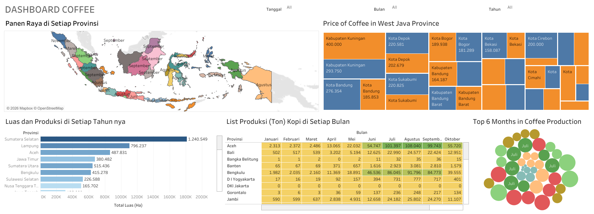
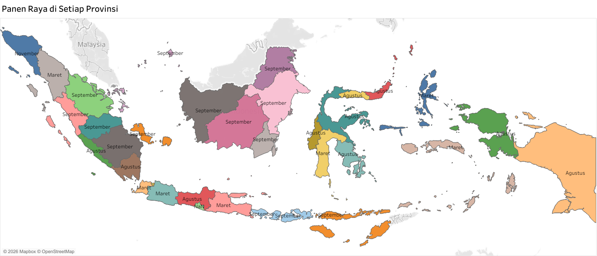
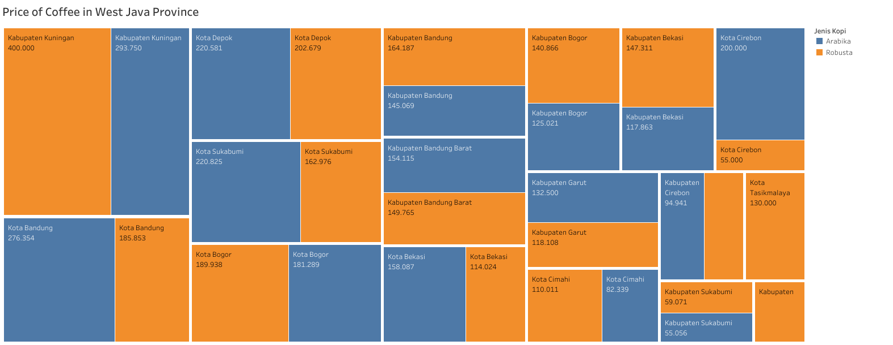
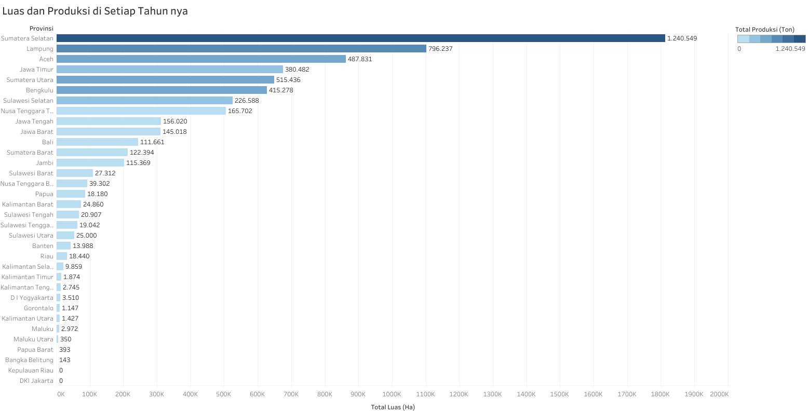
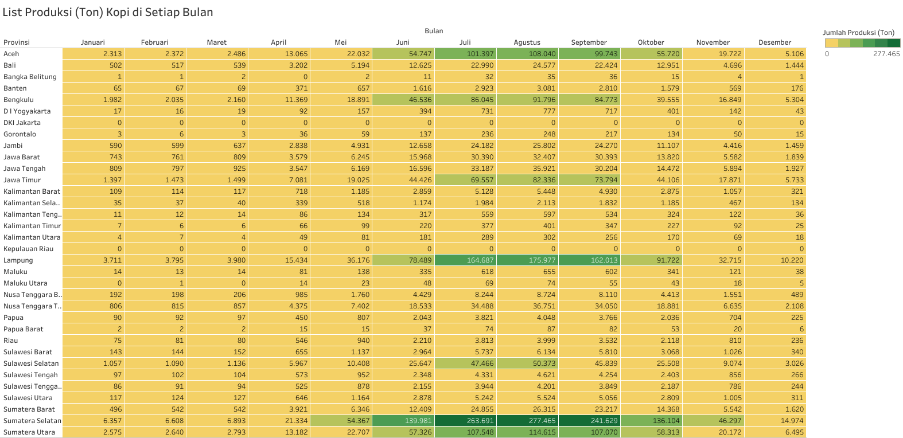
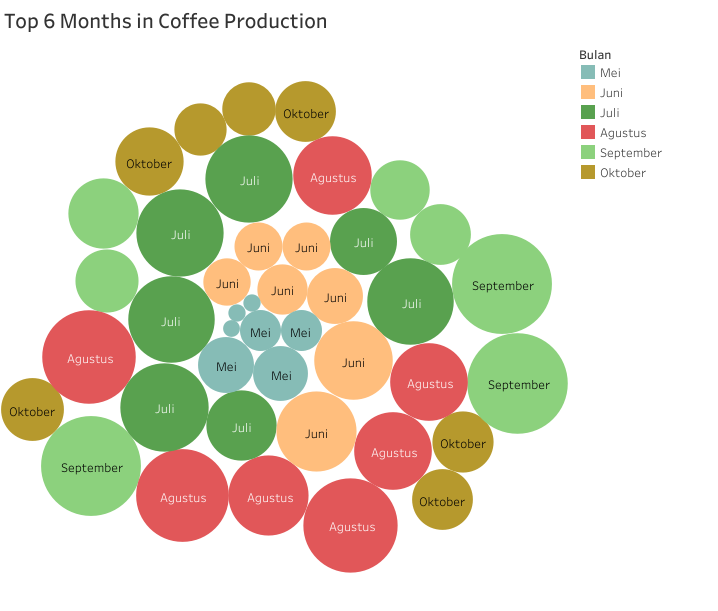

# Indonesia Coffee Production Dashboard (Tableau)

> An interactive Tableau dashboard analyzing Indonesian coffee production, peak harvest
> timing by province, and real coffee-market pricing in West Java.

Built during a Data Scientist internship at **Agree by Telkom Indonesia** (Feb – Jun 2024).

### 🔗 [**View the live, interactive dashboard on Tableau Public**](https://public.tableau.com/views/Project_v2_17194805411690/Dashboard1)

## Overview

Combines national agricultural statistics (land area, production volume, harvest timing)
with real West Java marketplace pricing data into one interactive dashboard — filterable
by date, month, and year — to answer questions like: which provinces produce the most
coffee, when does each province's peak harvest fall, and how much does Arabica vs. Robusta
coffee actually cost across West Java's cities and regencies.

## Data Collection & Methodology

1. **Collect** — National land-area and production statistics from Badan Pusat Statistik (BPS) and Open Data Jabar were downloaded directly. West Java market pricing, however, isn't published as open data, so it was collected via a custom Selenium + BeautifulSoup scraper (**[`scripts/scrape_tokopedia_coffee_prices.py`](scripts/scrape_tokopedia_coffee_prices.py)**) that searches Tokopedia for coffee listings and extracts seller, location, product name, price, rating, and units sold — yielding **8,816 real marketplace listings** across West Java's cities and regencies.
2. **Clean** — BPS records were stripped of nulls and merged across years; Open Data Jabar pricing was de-duplicated; scraped Tokopedia listings were standardized (price formatting, location naming) to match the other sources.
3. **Integrate** — All sources were joined into a single workbook (`Data_Coffee_v2.xlsx`) using shared keys (province ID, date) so Tableau could treat it as one connected data model.
4. **Analyze & Visualize** — Statistical analysis identified the relationship between harvest timing, production volume, and land area; results were visualized as the interactive Tableau dashboard below.

## Data Sources

- **`Luas_Terhadap_Produksi_Panen.csv`** — land area (Ha) vs. production volume (tons) by
  province and estate type (state-owned, private, and smallholder estates), 2022.
- **`Produksi_Kopi_per_Bulan.csv`** — monthly coffee production (tons) by province.
- **`Panen_Raya.csv`** — peak harvest month per province.
- **`Harga_Kopi_Jabar.csv`** — **8,816 real marketplace listings** of Arabica and Robusta
  coffee prices, collected across cities and regencies in West Java (seller, product, date,
  price).
- **`data/Data_Coffee_v2.xlsx`** — the consolidated, Tableau-ready workbook combining all of
  the above into the sheets the v2 dashboard connects to.

## Dashboard Sections

### Peak Harvest by Province

A choropleth map of Indonesia, color- and label-coded by each province's peak harvest
("panen raya") month — most of Sumatra and Sulawesi peak around August–September, while a
few provinces peak as early as March.

### Coffee Prices in West Java

A treemap of Arabica (blue) vs. Robusta (orange) coffee prices by city/regency, sized and
labeled by price. Kabupaten Kuningan shows the widest spread, with listings from Rp 293,750
up to Rp 400,000.

### Land Area vs. Production by Province

Total harvested area (Ha) per province, color-intensity-coded by total production (tons).
Sumatera Selatan leads on both area (1.24M Ha) and production, followed by Lampung and Aceh.

### Monthly Production by Province

A heatmap table of monthly production (tons) across all 34 provinces, making the
June–September production surge immediately visible — Sumatera Selatan alone produces
277,465 tons in July vs. just 6,357 in January.

### Top 6 Months in Coffee Production

A packed-bubble chart sizing each province-month combination by production volume, making
July and August the clear peak production months nationally.

## Version History

- **`Project_v1.twb`** — 4 standalone worksheets (Luas & Produksi, Panen Raya, Price
  Coffee, Produksi per Bulan), each connected to a separate CSV/Excel source.
- **`Project_v2.twb`** *(current)* — adds the Top 6 Months bubble chart, consolidates all
  data sources into a single `Data_Coffee_v2.xlsx` workbook, and combines all 5 worksheets
  into the unified, filterable **Dashboard 1** shown above.

## Tools

Tableau (Public/Desktop), Microsoft Excel, Python (Selenium, BeautifulSoup, Pandas) for data collection — see `requirements.txt`.

## How to View

**Easiest:** open the [live dashboard on Tableau Public](https://public.tableau.com/views/Project_v2_17194805411690/Dashboard1) —
fully interactive, no install needed.

**To edit it yourself:**
1. Install [Tableau Public](https://public.tableau.com/) (free) or Tableau Desktop.
2. Open `Project_v2.twb`.
3. The workbook's data connections point to the original author's local file paths and
   will show as **disconnected** after cloning. To fix: right-click each data source in the
   **Data** pane → **Edit Connection...** → browse to the matching file in this repo's
   `data/` folder (primarily `Data_Coffee_v2.xlsx`).
